<picture>
  <source media="(prefers-color-scheme: dark)" srcset="./assets/banner-dark.svg">
  <source media="(prefers-color-scheme: light)" srcset="./assets/banner-light.svg">
  
</picture>

 

I build things that sit close to the wire: proxy networks, fleets of browsers in microVMs, and the Go services that hold them together. These days that includes a lot of LLM tooling. Based in London.

### 🛰️ Now

**[Webscrape AI](https://webscrape.ai/)** · founder & engineer · since 2025

AI-powered web extraction and browser automation. Every Chromium session runs in its own Firecracker microVM (100+ per host, sub-500 ms boot), responses come back in under 700 ms on independent BrowserArena benchmarks, and it reached 100+ customers within four months of launch. Built solo, with Claude Code, custom MCP servers and CI-gated AI review doing a lot of the lifting.

### 📦 Before

- **SpeedProxies** · founder & engineer · 2020–2025 
  Residential, mobile and datacentre proxies for 10,000+ customers, with 400+ TB delivered over my own network, [AS208908](https://bgp.tools/as/208908).
- **59A** · software engineer · 2021–2025 
  Rebuilt a Python/Selenium Google Maps collector in Go with concurrent browser workers, cutting UK-wide runs from 4–5 hours to 30 minutes.

### 🧰 Stack

<table>
  <tr>
    <td><b>Languages</b></td>
    <td>
      
      
      
      
      
      
    </td>
  </tr>
  <tr>
    <td><b>Networking</b></td>
    <td>
      
      
      
      
      
      
      
    </td>
  </tr>
  <tr>
    <td><b>Infrastructure</b></td>
    <td>
      
      
      
      
      
      
      
    </td>
  </tr>
  <tr>
    <td><b>Data</b></td>
    <td>
      
      
      
      
      
      
    </td>
  </tr>
  <tr>
    <td><b>AI & LLMs</b></td>
    <td>
      
      
      
      
    </td>
  </tr>
</table>

 

